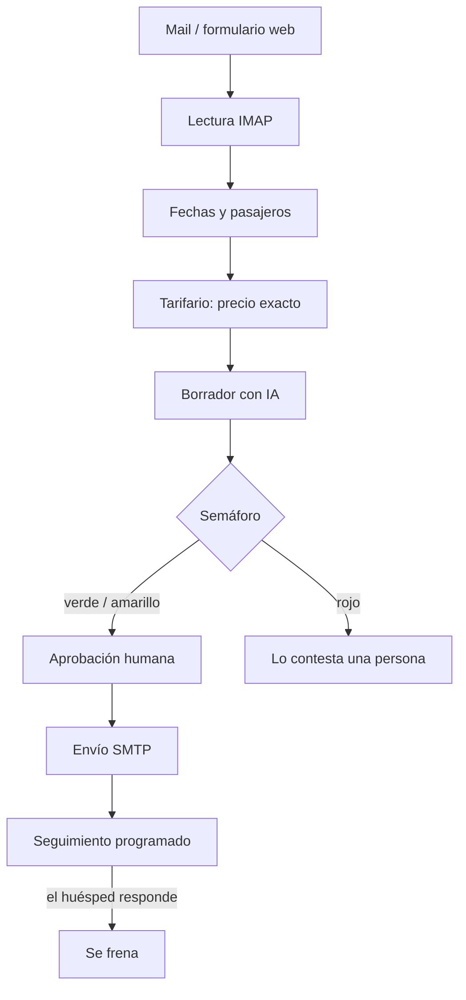
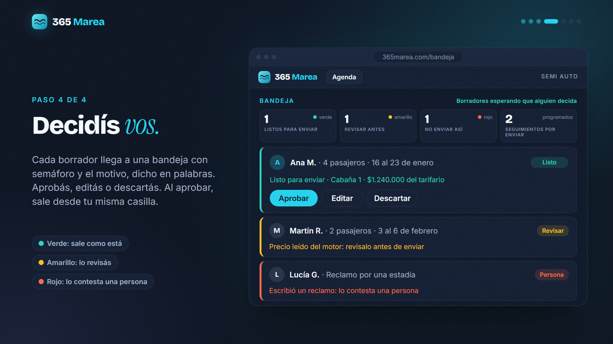

# 365 Marea

**CRM y seguimiento de consultas para alojamientos turísticos.**
Cada consulta con su borrador listo en minutos, con tus tarifas y reglas. Vos aprobás: nada sale solo.

[Ver el sitio · 365marea.com](https://365marea.com)

    

> **Estado:** en producción y en uso real con un alojamiento. El código es privado (lógica comercial y datos de clientes). Esta página documenta qué hace, cómo está construido y qué decisiones tomé. Puedo recorrer el código en una entrevista.

## El problema

Un alojamiento recibe consultas por mail y formularios todo el día. Responder rápido, con el precio correcto y haciendo seguimiento es trabajo repetitivo, y cada consulta que se enfría es una reserva que se pierde.

## Qué hace

1. **Lee** la consulta que llega por mail o formulario web.
2. **Entiende** fechas y cantidad de pasajeros.
3. **Redacta** un borrador con IA. El precio sale del tarifario, palabra por palabra: nunca inventa uno.
4. **Clasifica** con un semáforo: verde (sale como está), amarillo (conviene revisar) y rojo (lo contesta una persona).
5. **Espera tu aprobación.** Aprobás, editás o descartás. De fábrica nada sale solo; el modo automático es opcional y reversible.
6. **Hace seguimiento**: el mensaje ya está escrito y se frena si el huésped responde.
7. **Aprende** de lo que corregís.

Modos de trabajo: **prueba** (redacta pero no envía) → **semiautomático** (envía lo que una persona aprueba) → **automático** (opcional).

## Lo que demuestra este proyecto

| Área | Evidencia |
|---|---|
| **Constancia** | Más de 400 commits desde septiembre de 2026 |
| **Pruebas** | Más de 1.100 pruebas automáticas, un módulo de pruebas por funcionalidad |
| **Seguridad** | Pruebas de aislamiento de rutas y de archivos estáticos |
| **Accesibilidad y rendimiento** | Pruebas de accesibilidad y auditorías Lighthouse |
| **Despliegue** | VM Linux en Google Cloud, scripts de publicación y verificación, GitHub Actions para las pruebas |
| **Producto** | Sitio en español, inglés y portugués; límites claros de lo que la IA puede y no puede hacer |

## Stack

- **Backend:** Python, Flask, Jinja, SQLite.
- **Integraciones:** correo por IMAP y SMTP, modelos de IA para redactar con reglas del negocio.
- **Frontend:** HTML, CSS y JavaScript propios.
- **Infra:** Linux, Google Cloud Compute Engine, GitHub Actions.

## Decisiones que importan

- **La IA no escribe números.** El precio lo calcula el sistema desde el tarifario; la IA solo redacta alrededor.
- **Una persona decide.** Los casos sensibles (reclamos, cancelaciones) siempre van a una persona.
- **Datos de ejemplo ficticios** en capturas y demos: nunca datos de huéspedes ni de clientes.

## Capturas

  
  

*Interfaz ilustrativa, con datos de ejemplo.*

## Autor

**Manuel Dupuy** · [LinkedIn](https://linkedin.com/in/manueldupuy) · [Portfolio](https://angeldupuy.github.io)
